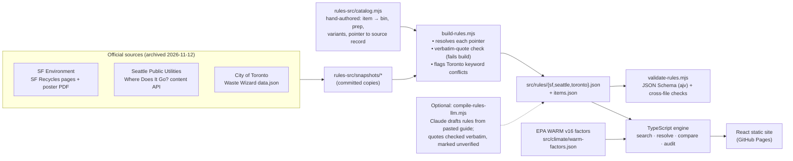

# SortLocal: recycling rules, by city

**Where does it go? It depends on where you live.** SortLocal turns three cities' official sorting guides into cited, machine-readable rules. A deterministic engine answers "which bin?" with a verbatim quote from the city. You can also compare cities side by side, or audit your own recycling bin for contamination and estimated CO₂e.

> Submitted to **Arbiter Hacks V1**, Theme track **“Rethinking Waste”**.
> Live demo: `https://sternjeong.github.io/contest-arbiter-hacks-v1/` (after GitHub Pages is enabled). It needs no sign-up and no API key.

| | San Francisco | Seattle | Toronto |
|---|---|---|---|
| Plastic grocery bag | Special: store take-back | Garbage | **Blue Bin** |
| Disposable diaper | Landfill | Garbage | **Green Bin (organics)** |
| “Compostable” PLA cup | Compost | Compost | **Garbage** |
| Empty paint can | Recycle | Garbage | **Hazardous-waste depot** |
| Paper egg carton | Recycle | **Compost** | Recycle |

Every cell above links back to an official source inside the app.

## Why

Contamination is one of the main reasons curbside recycling fails. Non-recyclables and food-soiled items lower bale value, jam sorting machinery and send whole loads to landfill. Much of it is **well-intentioned "wish-cycling"**, and generic advice makes it worse because the rules really are local. Of the 82 items that all three official guides cover, **33 (40%) do not go in the same bin in every city**. A generic "AI trash classifier" that answers "plastic bag → recycling" is right in Toronto and wrong in Seattle and San Francisco.

SortLocal takes a different approach. It does not guess what an object is. It encodes what each city actually says and shows its receipts.

## What it does

1. **Look up** any of 100 everyday items (fuzzy search tolerates typos, plurals and synonyms such as "k-cup" or "styrofoam"). You get the bin, the prep steps ("remove lid", "flatten", "bigger than 3 inches"), the "it depends" variants (for example "if greasy → compost"), and a **verbatim quote plus a link** to the official source. If a city's guide does not mention an item, SortLocal says so and does not invent an answer.
2. **Compare cities**: shows the same item in three columns, plus a ranked list of the 44 items where the cities disagree (three-way splits first).
3. **Bin audit**: count or weigh what is in your recycling bin and flag items that are dirty or bagged. SortLocal then:
   - computes the **contamination rate by weight** using *your city's* rules, including city-wide rules such as "loose, not bagged" (SF, Seattle) or "empty, clean, dry",
   - estimates **kg CO₂e avoided** by the correctly sorted material, plus the extra benefit if every fix were made (EPA WARM v16, clearly labeled as estimates),
   - returns a **prioritized fix list**: safety hazards (batteries, propane) first, then "tanglers" (bags, film, hoses) and food or liquid contamination, each with the rule that justifies it,
   - shows **the same bin scored in all three cities**. The example bin is 45% contaminated in SF, 48% in Seattle and 14% in Toronto,
   - **saves audits in your browser** (localStorage) and plots a before/after trend. "Apply all fixes" shows the "after" state in one click.
4. **Rules & sources**: lists every source, bin counts, city-wide rules and every unverified rule with the reason, plus the emission-factor table.
5. A **3-step guided tour** runs on first visit. Light and dark themes are supported. The layout is keyboard- and screen-reader-friendly (ARIA combobox, focus-trapped dialog, skip link) and works at 360 px phone width.

## How it works



- **Rules as code.** `src/rules/ruleset.schema.json` defines a ruleset: city, bin labels, sources, city-wide rules, and rules `{itemId, bin, prep[], conditions[], variants[], citation{sourceId,url,section,quote}, verified, note}`. A rule without a citation is a schema error, and an unverified rule must carry a `note`.
- **Citations are checked against the source.** `npm run rules:build` re-derives every quote from the archived snapshot. A test also asserts that every quote in every ruleset appears verbatim in the committed source copies. The test suite caught a real bug this way: the sentence splitter broke on "0.5 metre".
- **The engine is deterministic** (`src/engine/`). Search uses normalization, plural folding, prefix matching and Damerau-Levenshtein typo tolerance. The resolver applies "dirty" variants. The audit splits each item into accepted, wrong-bin, dirty or bagged, then computes mass, contamination rate, WARM (landfill − recycling) × short tons, and severity-weighted fixes. The app never calls a model.
- **The LLM is optional.** `npm run rules:compile` drafts a new city's ruleset from pasted guide text with `claude-sonnet-5-5`, using structured JSON output constrained to catalog item ids. It drops any rule whose quote is not found verbatim in the pasted text, marks every kept rule `verified: false`, and validates the result against the schema. It needs `ANTHROPIC_API_KEY`. Without a key it exits with an explanation, and `--from-response` post-processes a saved response offline.

## Coverage

| City | Rules | Unverified | Sources |
|---|---|---|---|
| San Francisco | 85 | 2 | SF Environment “SF Recycles” item pages; SF Environment trilingual poster (2023 PDF); Recology “Better at the Bin” |
| Seattle | 99 | 0 | SPU “Where Does It Go?” records; SPU “How to Sort at Home”; SPU “Seattle’s Recycling Process” |
| Toronto | 98 | 1 | City of Toronto Waste Wizard data |

**Unverified or caveated rules (shown in the app):**
- *SF, aerosol can:* the sources disagree. The current SF Recycles page says "Special handling", while the 2023 SF poster lists "Spray cans (must be empty)" under Recycle. SortLocal shows Special and explains the conflict.
- *SF, zip-top bag:* inferred from the "Plastic bags, plastic wrap" page, which doesn't name zip bags explicitly.
- *Toronto, stand-up pouch:* the Waste Wizard lists the same keyword under both the new Blue Bin flexible-plastics entry and an older Garbage entry. It was flagged automatically.
- *Not covered (shown as "No official rule"):* SF has no explicit entry for 15 catalog items (for example thermal receipts, pill bottles, coffee pods); Seattle has none for paper ice cream cartons (the source record for that item contains ice-cube-tray text); Toronto has none for loose plastic caps and certified compostable bags.
- Shredded paper (SF) comes from the 2023 poster, not a current item page. This is noted on the rule.

## Run it

```bash
cd app
npm ci
npm run dev          # http://localhost:5173/contest-arbiter-hacks-v1/
npm test             # vitest: schema, citations, resolver, audit math, UI smoke tests
npm run lint && npm run typecheck
npm run build        # validates rules, type-checks, builds to app/dist
npm run rules:build  # regenerate src/rules/*.json from rules-src/ (quote-checked)
```

`BASE_PATH=/ npm run build` builds for a root domain. The included workflow `.github/workflows/pages.yml` builds, tests and deploys to GitHub Pages on every push to `main`. Enable Pages in the repo settings with **Source: GitHub Actions**.

### Adding a city

1. Archive the official guide in `rules-src/snapshots/` (or paste its text into a file).
2. Either hand-author entries in `rules-src/catalog.mjs` and run `npm run rules:build`, or draft them with `ANTHROPIC_API_KEY=… npm run rules:compile -- --city "Name" --id slug --url https://… guide.txt`.
3. Review, run `npm run rules:validate`, and register the ruleset in `src/engine/data.ts`.

## Project layout

```
app/
  rules-src/        catalog.mjs (authored rules) · build-rules.mjs · snapshots/ (official source copies)
  src/rules/        generated rulesets + JSON schemas
  src/climate/      EPA WARM v16 factors (with exhibit references)
  src/engine/       search.ts · resolve.ts · audit.ts · storage.ts (pure TypeScript, no DOM)
  src/ui/           React views: Lookup, Compare, Audit, Sources, Tour
  scripts/          validate-rules.mjs · rules-validator.mjs · compile-rules-llm.mjs · compile-lib.mjs
  tests/            vitest suites
docs/submission/    DEVPOST.md · DEMO_SCRIPT.md · CHECKLIST.md
```

## Limitations

- **Three cities, 100 items.** Rules were encoded from the sources as archived on 2026-11-12, and cities change their rules. Toronto, for example, moved Blue Bin recycling to Circular Materials and expanded what it accepts. Each answer shows its archive date and links to the live source.
- **Multi-family and commercial rules differ.** SortLocal covers residential curbside guidance only.
- **CO₂e numbers are estimates.** They use U.S. national WARM factors with landfill as the counterfactual, and item masses are typical defaults rather than measurements. WARM has no recycling factor for film (LDPE) or polystyrene, so accepted film and foam (Toronto) are excluded from the avoided-emissions total, and the app says so.
- **The contamination model is intentionally simple.** It does not model downstream bale loss from a single contaminant.
- **No photo recognition.** That is a deliberate choice: identifying an object is not the hard part, and knowing the local rule is.

## Credits & citations

- San Francisco Environment Department: [SF Recycles](https://www.sfenvironment.org/sfrecycles) and [Recycle/Compost/Landfill posters](https://sfenvironment.org/files/sfe_zw_posters_85x11_vertical_trilingual.pdf); Recology: [Better at the Bin](https://www.recology.com/better-at-the-bin/).
- Seattle Public Utilities: [Where Does It Go?](https://www.seattle.gov/utilities/your-services/collection-and-disposal/where-does-it-go), [How to Sort at Home](https://www.seattle.gov/utilities/your-services/collection-and-disposal/how-to-sort-at-home), [Seattle's Recycling Process](https://www.seattle.gov/utilities/your-services/collection-and-disposal/recycling/recycling-process).
- City of Toronto: [Waste Wizard](https://www.toronto.ca/services-payments/recycling-organics-garbage/waste-wizard/).
- U.S. EPA: WARM v16 documentation, [Containers, Packaging & Non-Durable Goods](https://www.epa.gov/system/files/documents/2023-12/warm_containers_packaging_and_non-durable_goods_materials_v16_dec.pdf) and [Organic Materials](https://www.epa.gov/system/files/documents/2023-12/warm_organic_materials_v16_dec.pdf).
- Built with Vite, React, TypeScript, Ajv and Vitest. The optional rule compiler uses the Anthropic SDK.

SortLocal is an independent student project and is not affiliated with or endorsed by any city or hauler. Always defer to your local program.
